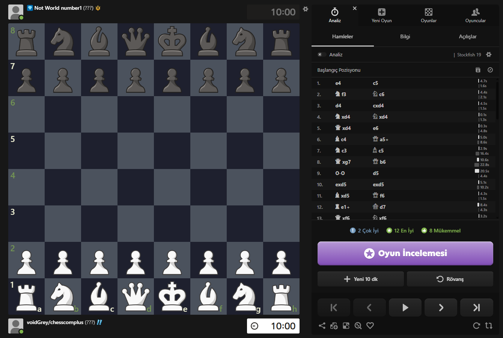
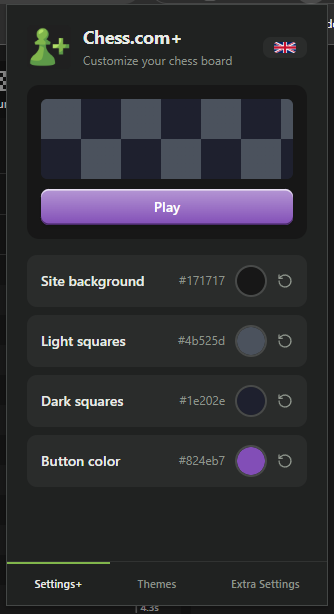
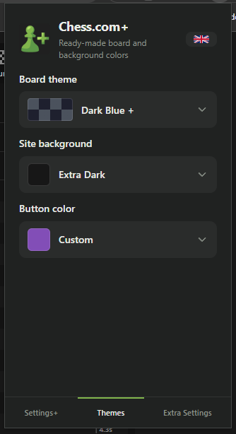
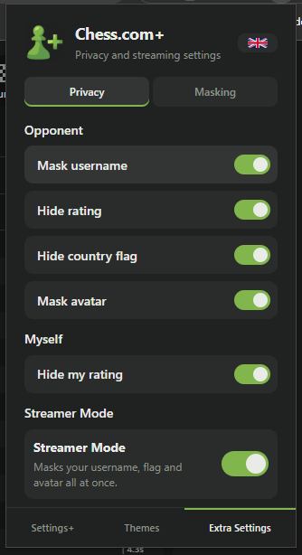
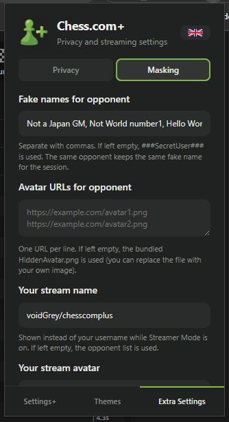

# Chess.com+

**Customize Chess.com your way — board themes, privacy tools and a one-click Streamer Mode.**

A Manifest V3 browser extension that lets you restyle Chess.com and stay private while playing or streaming.



## ✨ Features

### 🎨 Theming
- Recolor **board squares**, **site background** and **primary buttons** with live animated transitions
- Ready-made **board themes** (Wood, Sky, Dark Blue +, Rose…) and background palettes
- Button tones (highlight, shadow, text) are **derived automatically** from any color — dark colors keep visible shadows, light colors get readable text
- Instant preview in the popup; everything syncs across browsers

### 🛡️ Privacy (Opponent)
- **Mask usernames** with your own list of fake names — the same opponent keeps the same fake name for the session
- **Hide ratings** — shown as `(???)` everywhere, including end-of-game screens
- **Hide country flags**
- **Mask avatars** — replace them with a bundled placeholder or your own image URLs

### 📺 Streamer Mode
- One switch hides **your** username, flag and avatar — with your own **stream name** and **stream avatar**
- Independent **"Hide my rating"** toggle, applied on the board and in every game-over screen
- End-of-game rating card and `+8/-8` deltas are masked too

### 🌐 Interface Languages
English · Türkçe · 日本語 · 中文（简体）· Русский · Deutsch — with a flag-based language picker. [Add your own language →](#-adding-a-new-language)

## 📸 Screenshots

| Settings+ | Themes |
|---|---|
| Color pickers with live preview | Ready-made board, background and button themes |
|  |  |

| Extra Settings — Privacy | Extra Settings — Masking |
|---|---|
| Opponent toggles, "Hide my rating" and Streamer Mode | Fake names, avatar URLs, stream name & avatar |
|  |  |

| On Chess.com |
|---|
| Masked opponent, `(???)` rating and a custom board theme during game review |
|  |

## 🚀 Installation

### Option 1 — From a Release (recommended)

1. Go to the **[Releases](../../releases)** page and download the latest `chess-plus-vX.X.X.crx`
2. Open `chrome://extensions` (or `edge://extensions`, `brave://extensions`)
3. Enable **Developer mode** (top right)
4. Drag the downloaded `.crx` file onto the extensions page and confirm the installation
5. Pin **Chess.com+** to your toolbar and open any `chess.com` page

> Chrome may show a warning for extensions installed this way — that is normal for releases not published on the Chrome Web Store. If your browser refuses to install the `.crx`, use Option 2 below.

### Option 2 — From Source (unpacked)

1. Clone or download this repository
2. Open `chrome://extensions` and enable **Developer mode**
3. Click **Load unpacked** and select the repository folder
4. Pin **Chess.com+** to your toolbar and open any `chess.com` page

> After reloading the extension, if clicking the icon does nothing, toggle the extension off/on on the extensions page — a known unpacked-reload quirk.

## 🧭 Usage

- **Settings+** — fine-tune colors; the **reset** button appears only when a value differs from the default
- **Themes** — one-click presets for board, background and buttons
- **Extra Settings → Privacy** — per-feature switches for your opponent and yourself
- **Extra Settings → Masking** — comma-separated fake names, one avatar URL per line, and your stream identity

All settings persist via `chrome.storage.sync` and apply live to open tabs.

## 🌍 Adding a New Language

1. Copy any file in [`locales/`](locales) and rename it with the language code (e.g. `ko.js`); fill in the translations, keep the keys identical to the other files, and set `"flag"` to an ISO country code (e.g. `"kr"`)
2. Add `<script src="locales/ko.js"></script>` **above** the `i18n.js` line in every HTML page (alphabetically, under `en.js`)

The language picker updates automatically — nothing else to touch.

## 🗂️ Project Structure

```
├── manifest.json          # MV3 manifest
├── content/               # Content script (runs on chess.com)
│   ├── colors.js          #   color conversion tools (hex/rgb/hsl)
│   ├── masking.js         #   hiding & masking engine + DOM observer
│   └── main.js            #   state, CSS variables, color animation, events
├── content.css            # page styles (board, buttons, hide classes)
├── popup.html/.css/.js    # Settings+ page
├── themes.html/.js        # Themes page (shared dropdown component)
├── themes-data.js         # ready-made theme definitions
├── extra.html/.js         # Extra Settings page (privacy & masking)
├── shared.js              # helpers shared by popup pages
├── i18n.js                # translation engine + language picker
├── locales/               # one dictionary file per language
└── HiddenAvatar.png       # default avatar mask (replace with your own)
```

## 🔒 Permissions & Privacy

- Uses only the **`storage`** permission — no network calls, no analytics, no data collection
- Flag images are fetched from the open-source [flagcdn.com](https://flagcdn.com) (MIT)
- Everything runs locally; your settings sync through your browser profile

## 📄 License

[MIT](LICENSE) — feel free to fork, improve and share.
